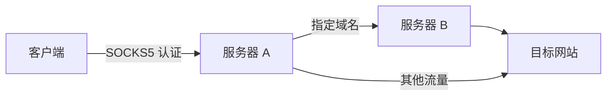

# 轻量 SOCKS5 部署与分流管理

使用 **Bash + jq + JSON 文本模板** 完成安装、SOCKS5 入站/出站配置和维护。Xray 提供代理服务：客户端连接 A，A 将指定域名交给 B 转发，其余流量直连。

源码仓库：[vatebur/socks5-router](https://github.com/vatebur/socks5-router)。



## 一键安装

在服务器的 SSH 终端执行一条命令。安装器从 GitHub 下载最新稳定版安装包和 `SHA256SUMS`，校验后打开交互菜单：

```bash
socks5_installer=$(mktemp) && curl -fsSL https://raw.githubusercontent.com/vatebur/socks5-router/main/install.sh -o "$socks5_installer" && sudo bash "$socks5_installer"; rm -f -- "$socks5_installer"
```

选择 `1. SOCKS5 部署（入站 / 出站）`。需要中转时，先在上游机器配置入站，再在中转机器配置入站和出站。安装器会拒绝缺少 Bash 模块的旧发行包。

手动下载参见 [GitHub Releases](https://github.com/vatebur/socks5-router/releases)。

```bash
sha256sum -c SHA256SUMS
tar -xzf socks5-router-v0.4.0.tar.gz
cd socks5-router
sudo bash socks5.sh
```

## 运行要求

- 使用 systemd 的 Linux 服务器；x86_64 / amd64 或 aarch64 / arm64。
- Bash 4+、jq 1.6+、curl、unzip、iproute / iproute2、util-linux、coreutils 和 CA 证书。
- 安装与维护需要 root；离线校验和生成 JSON 可使用普通用户。
- 系统依赖支持通过 apt、dnf、yum 安装；Xray 固定为 [v26.3.27](https://github.com/XTLS/Xray-core/releases/tag/v26.3.27)，使用内置 SHA256 校验。

## 依赖检查与下载

1. 一键安装器先准备 `curl`、`jq`、`tar`、SHA256 校验工具、`awk`、临时文件工具及 CA 证书。
2. 管理脚本补齐 `unzip`、`ss`、`flock`、`timeout`、coreutils、服务账号工具等运行依赖；已有可用工具直接复用。
3. 自动选择 `apt-get`、`dnf` 或 `yum`，刷新软件源后安装对应软件包。`ss` 对应 Debian/Ubuntu 的 `iproute2` 或 RPM 系统的 `iproute`；CentOS 缺少 jq 时会先准备 EPEL。
4. 安装后重新检查工具和 jq 版本，要求 jq 1.6+；软件源、下载或检查失败时停止并显示错误。

普通用户执行 `validate` / `render` 时只检查 jq。若需要自动安装，请使用 sudo。下载一键安装器本身需要服务器已有 curl；手动下载 `install.sh` 后执行 `sudo bash install.sh` 也可自动补齐 curl。

## 灵活部署 SOCKS5 入站与出站

部署入口参考 [v2ray-agent 的 SOCKS5 入站与出站菜单](https://github.com/mack-a/v2ray-agent/blob/master/install.sh)，统一入口内可分别配置入站、出站，无需选择固定的 A/B 角色。

### 入站

选择 `1. SOCKS5 部署` → `1. 安装 SOCKS5 入站`：

1. 用户名和密码：回车或输入 `auto` 自动生成 UUID，也可手动输入。自动生成的用户名和密码会立即打印到控制台。
2. 端口：回车或输入 `auto` 自动选择空闲端口，并立即打印；也可手动输入。
3. 来源白名单：可选配置可信来源 IP / CIDR。

不提供自定义监听 IP 输入。IPv6 启用时使用 `::`，否则使用 `0.0.0.0`；是否同时接受 IPv4/IPv6 连接取决于目标系统的双栈支持。部署后会打印实际监听地址、端口、用户名、密码和菜单引导。

仅配置入站时，全部流量由本机直连，可作为客户端代理或其他机器的上游。已有入站请通过 `4. 修改配置` → `1. 修改 SOCKS5 入站配置` 修改账号、端口或白名单，出站配置会保留。

### 出站与分流

选择 `1. SOCKS5 部署` → `2. 安装 SOCKS5 出站及分流`。也可以先安装出站，稍后添加入站；仅配置出站时不监听客户端端口，服务保持停止并关闭开机启动。

已有出站请通过 `4. 修改配置` → `2. 修改 SOCKS5 出站配置` 修改上游连接信息、域名列表或分流模式。

| 模式 | 输入内容 | 访问路径 |
| --- | --- | --- |
| `1` 按域名分流 | 上游连接信息、域名列表 | 匹配域名通过上游，其余由本机直连 |
| `2` 跳过分流 | 无需上游和域名列表 | 清除出站及域名配置，全部由本机直连 |
| `3` 全局代理 | 上游连接信息 | 全部通过上游，无需域名列表 |

出站使用上游的实际可达地址、端口、用户名和密码，不会自动生成上游账号。启用出站时，应用前执行真实 SOCKS5 用户名密码认证；连接失败、认证失败或超时会拒绝新配置。认证检查不代表上游能访问所有目标网站。

例如：先在服务器 B 配置入站；再在服务器 A 配置入站，并将 B 的连接信息填入 A 的出站。入站白名单填写连接方的实际出口 IP；B 可仅允许 A 的出口 IP。云安全组和现有防火墙需放行各机器的 TCP 入站端口。

### 分别卸载入站与出站

在 `1. SOCKS5 部署` 内选择：

- `3. 卸载 SOCKS5 入站`：清除监听端口、入站账号密码与白名单，停止服务并关闭开机启动，保留出站与分流配置；之后可重新安装入站。
- `4. 卸载 SOCKS5 出站及分流`：清除上游与域名分流，保留入站账号、端口和白名单，现有入站恢复本机直连。

这两项操作需输入 `y` 确认。管理脚本与 Xray 核心保留；如需彻底卸载整个项目，使用主菜单 `7. 卸载全部`。

## 来源 IP 限制

实现参考 [v2ray-agent 的 `setSocks5InboundRouting`](https://github.com/mack-a/v2ray-agent/blob/master/install.sh)：使用代理核心的来源 IP 路由条件允许指定来源，并配置阻断出站兜底。本工具使用对应的 Xray `source` 条件。

启用白名单后，允许转发的域名规则和默认规则都必须同时匹配来源 IP；其他来源进入 `blocked` 出站。该方式限制代理转发，TCP 建连和账号认证仍可能完成，行为与参考项目的核心路由限制一致。

支持 IPv4、IPv6、CIDR，使用空格、逗号或分号分隔：

```text
203.0.113.10 198.51.100.0/24 2001:db8::10 2001:db8:1234::/48
```

开启时至少填写一个条目；关闭后所有能连接入站的来源均可尝试账号认证。脚本不修改系统防火墙。

## 域名与客户端

| 输入 | 匹配范围 |
| --- | --- |
| `example.com` / `domain:example.com` | 本域及所有子域 |
| `*.example.com` | 归一化为 `domain:example.com`，包含本域和子域 |
| `full:api.example.com` | 仅精确匹配该域名 |

域名列表支持空格、逗号或分号分隔；不接受 URL、路径、端口或 IP。国际化域名请填写 Punycode。用户名和密码各限制为 1–255 个 UTF-8 字节，不能包含控制字符。

客户端填写 A 的可达地址、端口和入站账号，并启用**远程 DNS / 代理 DNS / socks5h**：

```bash
curl --proxy socks5h://203.0.113.10:21080 \
  --proxy-user 'A_USERNAME:A_PASSWORD' https://example.com/
```

按域名分流依赖 SOCKS5 请求中的域名；如果客户端先解析 DNS 并仅提交 IP，该请求按默认规则直连。全局代理模式下 IP 目标也通过 B。脚本关闭流量嗅探。

## 日常维护

使用 `socks5-router` 呼出菜单，普通用户运行 `sudo socks5-router`。

首次打开菜单时就会安装管理命令；即使暂未配置入站/出站或核心下载失败，也能用该命令重新进入菜单。命令入口丢失时，运行 `sudo bash /home/socks/socks5.sh`（请替换为实际源码路径）即可重新安装入口。

终端菜单使用彩色标题与分组：错误为红色，成功为绿色，提醒为黄色，普通信息为青色。输出重定向或 `TERM=dumb` 时自动关闭颜色；设置 `NO_COLOR=1` 也可关闭颜色。`show` / `render` 的 JSON 输出保持原有格式。

版本更新记录见 [GitHub Releases](https://github.com/vatebur/socks5-router/releases)。

| 菜单 | 功能 |
| --- | --- |
| `1` | 分别安装、卸载 SOCKS5 入站与出站 |
| `2` | 查看完整配置及账号密码 |
| `3` | 检查配置、上游认证、服务状态和最近 40 条日志 |
| `4` | 分别修改入站配置、出站配置 |
| `5` | 服务管理：启动/重启、停止服务 |
| `6` | 下载并校验 GitHub 最新稳定版，升级管理脚本与 JSON 模板 |
| `7` | 卸载全部（输入 `DELETE` 确认） |

尚未配置时，查看、检查、修改和服务管理会提示先安装。修改或单独卸载入站/出站时，会检查对应组件是否已安装；没有入站时，启动服务会提示先安装入站。综合检查发现配置或认证问题后，仍会显示服务状态和日志。

修改先验证输入、端口和 Xray 配置，再短暂停止服务并原子替换文件。启动失败会恢复旧文件和运行状态；恢复失败则保持停止并报告错误。若系统无法停止候选服务，会保留当前配置并报告错误。

停止服务仍保留开机启动设置。同一服务器管理一个实例，入站与出站可分别维护。修改上游入站账号或端口后，还需在连接它的机器同步更新出站。

### 彻底卸载

选择 `7. 卸载全部`，输入 `DELETE` 确认。脚本停止并禁用服务，删除 systemd 服务文件、开机启动链接及服务专用配置目录，清除 `/etc/socks5-router/`、`/usr/local/lib/socks5-router/`、`/usr/local/bin/socks5-router` 和 `/run/socks5-router.lock`，并删除 `socks5-router` 专用无登录系统账号及同名用户组。核心、全部凭据和旧配置备份随专用目录一起删除。

没有 `state.json` 或安装中途失败时，也可使用此入口清理残留。删除失败会报告错误，不会提示卸载成功；修正后可再次运行卸载。

### 升级

选择 `6. 升级`，或执行 `sudo socks5-router upgrade`。升级器从 GitHub 下载最新稳定版安装包与 SHA256SUMS，校验后检查新版本能否读取现有配置、是否通过当前 Xray 核心检查，以及生成的运行配置是否一致。通过后更新管理脚本与 JSON 模板，保留配置、凭据、端口及服务运行状态；完成后使用 `socks5-router` 呼出新版菜单。

相同版本提示已是最新版，较低版本不会覆盖当前版本；下载、校验、兼容检查失败时不修改安装文件，文件安装失败时恢复原管理脚本。

从 v0.2.0 / v0.3.0 升级到本版，先运行一键安装命令即可更新管理脚本，保留已有配置。从 v0.1.0 升级时，先备份 `/etc/socks5-router/state.json`，使用旧版本菜单卸载，再安装新版本。

```bash
sudo socks5-router check
sudo socks5-router show
sudo systemctl status socks5-router --no-pager
sudo journalctl -u socks5-router -n 80 --no-pager
```

## 文件与 JSON 模板

| 路径 | 用途 |
| --- | --- |
| `/etc/socks5-router/state.json` | 实际配置与凭据，权限 `0600` |
| `/etc/socks5-router/config.json` | Xray 运行配置，权限 `0640` |
| `/usr/local/lib/socks5-router/socks5.sh` | Bash 管理脚本 |
| `/usr/local/lib/socks5-router/install.sh` | 共用依赖检查与安装函数、GitHub 下载入口 |
| `/usr/local/lib/socks5-router/lib/config.sh` | Bash 校验、端口与认证函数 |
| `/usr/local/lib/socks5-router/templates/` | JSON 文本模板与 jq 渲染规则 |
| `/usr/local/bin/socks5-router` | 管理入口 |
| `/etc/systemd/system/socks5-router.service` | systemd 服务 |

用户输入均作为 jq 字符串或 JSON 值处理，密码中的引号、反斜线和 `$` 不会成为脚本代码。通过菜单维护配置，避免状态文件与运行 JSON 不一致。

完整状态示例见 [A](examples/server-a.json) 和 [B](examples/server-b.json)，账号和 IP 均为占位内容；A 的出站账号与 B 的入站账号对应。

```bash
bash socks5.sh validate --state examples/server-a.json
bash socks5.sh render --state examples/server-a.json --output /tmp/xray.json
```

这些命令不安装服务或连接 B。输出文件权限为 `0600`；省略 `--output` 会向终端显示完整 JSON 及凭据。

## 离线核心安装

从 [Xray 官方 Release](https://github.com/XTLS/Xray-core/releases/tag/v26.3.27) 下载 `Xray-linux-64.zip` 或 `Xray-linux-arm64-v8a.zip`，再运行：

```bash
sudo bash socks5.sh --xray-archive /path/Xray-linux-64.zip
```

仍会验证固定 SHA256。系统依赖需提前准备或通过软件源安装。

## 开发检查与发布打包

```bash
for file in socks5.sh install.sh lib/config.sh scripts/build_release.sh; do bash -n "$file" || break; done
bash socks5.sh validate --state examples/server-a.json
bash socks5.sh validate --state examples/server-b.json
bash scripts/build_release.sh
```

可使用已下载的 Xray 核心检查生成的运行配置：

```bash
bash socks5.sh render --state examples/server-a.json --output /tmp/socks5-xray.json
/absolute/path/to/xray run -test -config /tmp/socks5-xray.json
```

功能参考：[mack-a/v2ray-agent](https://github.com/mack-a/v2ray-agent)。核心配置参考 Xray 官方 [SOCKS 入站](https://xtls.github.io/config/inbounds/socks.html)、[SOCKS 出站](https://xtls.github.io/config/outbounds/socks.html)、[路由](https://xtls.github.io/config/routing.html)。
