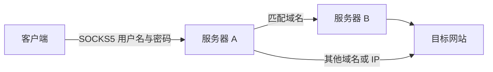

# 轻量 SOCKS5 部署与分流管理

中文交互式脚本，使用一个 Xray 进程提供 SOCKS5 服务。服务器 A 接收客户端连接，根据域名规则选择直连或通过服务器 B 转发；服务器 B 提供带账号认证的 SOCKS5 上游。



源码仓库：[vatebur/socks5-router](https://github.com/vatebur/socks5-router)。安装包见 [GitHub Releases](https://github.com/vatebur/socks5-router/releases)；下载压缩包和 `SHA256SUMS`，在同一目录执行：

```bash
sha256sum -c SHA256SUMS
tar -xzf socks5-router-v0.1.0.tar.gz
cd socks5-router
sudo bash socks5.sh
```

先部署 B，再部署 A。安装包包含脚本、使用说明、配置示例和测试，Xray 核心在安装服务时下载。

## 运行要求

- 使用 systemd 的 Linux 服务器，CPU 为 x86_64 / amd64 或 aarch64 / arm64。
- Bash、Python 3.9+、nftables、CA 证书及 root 权限。管理程序仅使用 Python 标准库，无需 pip。
- 可访问发行版软件源及 GitHub Release；也支持提前下载 Xray 安装包。
- 固定使用 [Xray v26.3.27](https://github.com/XTLS/Xray-core/releases/tag/v26.3.27)，按架构校验脚本内置的 SHA256。

缺少 Python 时，入口脚本会尝试使用 apt、dnf 或 yum 安装；安装服务时会检查 nftables。系统软件源若仅提供较旧的 Python，需先自行安装 Python 3.9+。普通容器通常缺少 systemd 或修改 nftables 的权限，建议在完整服务器或虚拟机上运行。

本工具提供 **TCP CONNECT**，不支持 UDP ASSOCIATE 或 BIND。SOCKS5 本身不加密账号和传输链路，跨不可信网络使用时应配合可信私网或加密隧道。

## 快速部署：先 B，后 A

把以下三个文件复制到两台服务器的同一目录，然后进入该目录：

```text
socks5.sh
socks5.py
socks5_config.py
```

下文使用的 IP、账号和端口均为示例，需换成实际值：

| 项目 | 示例 |
| --- | --- |
| A 的公网出口 IP | `203.0.113.10` |
| B 的可达 IP | `198.51.100.20` |
| 客户端公网出口 IP | `203.0.113.30` |
| A 的 SOCKS5 端口 | `21080` |
| B 的 SOCKS5 端口 | `22080` |

### 1. 在 B 上安装

```bash
sudo bash socks5.sh
```

选择 `2. 部署服务器 B`，依次填写：

1. 用户名：输入 `auto` 或直接回车，自动生成 UUID；也可手动填写。
2. 密码：回车或输入 `auto` 自动生成 UUID；也可手动填写，输入时不回显。
3. 监听地址：默认 `0.0.0.0`。Xray 的 `0.0.0.0` 与 `::` 通配监听在部分系统上均可能接受双栈连接；只需 IPv4 时可绑定服务器实际的 IPv4 地址。
4. 端口：输入 `auto` 或回车选择空闲端口，也可填写 `22080`。
5. 来源 IP 白名单：选择 `y`，填写 A 连接 B 时实际使用的出口 IP，例如 `203.0.113.10`。

安装完成后保存 B 的实际用户名、密码、端口和可达地址；默认监听地址 `0.0.0.0` 不能作为 A 的上游地址。B 的账号必须填写到 A 的出站配置中。

在 B 的云安全组和已有主机防火墙中放行该 TCP 端口，来源限制为 A 的出口 IP。若 A 通过 NAT 出网，应填写 NAT 后的公网 IP；若 A 使用 IPv6 连接 B，应填写相应的 IPv6 来源地址。

### 2. 在 A 上安装

```bash
sudo bash socks5.sh
```

选择 `1. 部署服务器 A`，配置 A 的入站账号、监听端口及客户端来源白名单。账号和端口同样支持自动生成或手动输入。A 的来源白名单应填写客户端实际出口 IP，例如 `203.0.113.30`。

选择需要的分流模式：

| 模式 | 输入内容 | 访问路径 |
| --- | --- | --- |
| `1. 按域名分流` / `domain` | B 的实际连接信息、域名列表 | 命中域名通过 B，其余由 A 直连 |
| `2. 跳过分流` / `direct` | 无需 B 和域名列表 | 全部由 A 直连 |
| `3. 全局代理` / `global` | B 的实际连接信息，无需域名列表 | 全部通过 B |

选择按域名分流或全局代理后，按提示填入 B 的地址、端口、用户名和密码。**这里应填写 B 上已经存在的账号，脚本不会为 B 重新生成账号。** 按域名分流还需输入域名，例如：

```text
example.com full:api.example.net
```

按域名分流及全局代理模式在应用前会连接 B，并验证其 SOCKS5 用户名密码认证；网络不通或账号不匹配时不应用新配置。跳过分流模式不依赖 B。

在 A 的云安全组和已有主机防火墙中放行 A 的 TCP 监听端口，来源限制为允许使用代理的客户端。

### 3. 配置客户端

客户端使用 A 的可达 IP、A 的端口、A 的入站用户名和密码，选择 SOCKS5，并启用“代理 DNS”“远程 DNS”或对应的 `socks5h` 选项。

以 curl 为例，将占位内容换成 A 的实际连接信息：

```bash
curl --proxy socks5h://203.0.113.10:21080 \
  --proxy-user 'A_USERNAME:A_PASSWORD' \
  https://example.com/
```

按域名分流依赖客户端在 SOCKS5 请求中提交域名。若客户端先在本地解析 DNS，向 A 只提交 IP，A 无法按原始域名匹配，该连接会按默认规则由 A 直连。脚本关闭流量嗅探，不从 HTTP Host 或 TLS SNI 推测域名。全局代理模式下，域名和 IP 目标均通过 B。

## 域名和白名单写法

域名、白名单均支持空格、逗号或分号分隔，包括中文逗号和分号。

| 域名输入 | 匹配范围 |
| --- | --- |
| `example.com` | `example.com` 及其子域名 |
| `domain:example.com` | `example.com` 及其子域名 |
| `*.example.com` | 归一化为 `domain:example.com`，包含主域名及子域名 |
| `full:api.example.com` | 仅 `api.example.com` |

域名不接受 URL、路径、端口或 IP，例如应填写 `example.com`，不能填写 `https://example.com/path`。支持国际化域名，会转换为 IDNA 格式，并去除重复项。

白名单支持 IPv4、IPv6 和 CIDR，例如：

```text
203.0.113.10 198.51.100.0/24 2001:db8::10 2001:db8:1234::/48
```

启用白名单时至少需要一个地址或网段；关闭白名单后，所有能够连接监听端口的来源均可尝试账号认证。用户名和密码各限制为 1–255 个 UTF-8 字节，不能包含控制字符。

## 日常维护

安装后在对应服务器运行：

```bash
sudo socks5-router
```

| 菜单 | 功能 |
| --- | --- |
| 3 | 查看配置，隐藏密码 |
| 4 | 显式显示完整配置和账号密码 |
| 5 | 检查状态文件、生成配置、Xray 语法、实际内核白名单、服务运行状态和 B 的账号认证 |
| 6 | 修改账号密码、监听地址/端口、白名单；A 还可修改 B 的连接信息、域名和模式 |
| 7 / 8 | 启动或重启 / 停止服务 |
| 9 | 查看服务状态和最近日志 |
| 10 | 恢复上一次成功应用前的配置 |
| 11 | 重新应用当前配置 |
| 12 | 卸载本工具创建的服务、配置、备份和防火墙表 |

修改前会进行输入、端口、Xray 配置和 nftables 规则检查；涉及 A 使用 B 时还会验证上游认证。应用过程会短暂停止服务，原子写入文件并更新专用防火墙表，成功后重新启动并设置开机启动。应用失败时尝试恢复旧配置、防火墙和原有运行状态；若恢复本身失败，会停止服务并报告具体错误。若 systemd 无法停止服务，则保留当前配置及过滤规则并报告错误。

每次成功修改保留一份上一版配置。菜单 10 恢复后，刚替换掉的配置成为新的上一版；恢复涉及 B 的模式时，同样要求 B 认证成功。菜单 8 仅停止当前服务，仍保留开机启动设置。卸载需输入 `DELETE`，会保留专用的无登录系统账号 `socks5-router`。

同一服务器管理一个实例。切换 A/B 角色需先卸载再重新部署。修改 B 的账号或端口后，还需要在 A 上同步修改 B 的连接信息。

也可直接检查或查看配置：

```bash
sudo socks5-router check
sudo socks5-router show
sudo systemctl status socks5-router --no-pager
sudo journalctl -u socks5-router -n 80 --no-pager
```

## 配置与服务文件

| 路径或名称 | 用途 |
| --- | --- |
| `/etc/socks5-router/state.json` | 管理状态和实际凭据，权限 `0600` |
| `/etc/socks5-router/config.json` | 生成的 Xray 配置，权限 `0640`，供专用服务账号读取 |
| `/etc/socks5-router/previous.json` | 上一次配置，含凭据，权限 `0600` |
| `/usr/local/lib/socks5-router/` | Xray 二进制和 Python 管理模块 |
| `/usr/local/bin/socks5-router` | 后续管理入口 |
| `/etc/systemd/system/socks5-router.service` | systemd 服务定义 |
| `inet socks5_router` | 本工具专用的 nftables 表 |

通过菜单修改配置，以保持 `state.json`、Xray 配置和防火墙一致。直接编辑生成的 `config.json` 会在下一次应用时被覆盖。配置和上一版备份包含明文凭据，复制备份时应保留访问权限。

服务启动前，systemd 会加载来源白名单；加载失败则不启动 Xray。白名单在独立的 nftables 表中更新，不清空其他软件的防火墙规则，也不会覆盖已有防火墙的拒绝策略，因此可信 IP 仍需通过云安全组及现有主机防火墙规则。绑定具体监听 IP 时，过滤仅作用于该地址和端口；绑定通配地址时覆盖该端口的所有本地地址。

若执行 `nft flush ruleset`，或其他防火墙管理工具重载时清除了本工具的表，请运行 `sudo systemctl restart socks5-router` 重新加载白名单。Xray 同时配置了来源路由限制，作为第二层保护；它只阻止未授权来源转发，不能替代 nftables 对 TCP 连接的限制。

## 配置示例与离线检查

完整示例见 [服务器 A](examples/server-a.json) 和 [服务器 B](examples/server-b.json)。示例使用文档保留 IP 和显式占位账号，不可直接用于真实部署。A 示例中的 `upstream` 账号、密码和端口与 B 示例一致。

状态文件使用 `schema: 1`。`whitelist: []` 表示关闭来源白名单；B 固定为 `mode: "direct"`、`domains: []` 和 `upstream: null`；A 的 `direct` 模式可不填写上游，`global` 模式无需域名，`domain` 模式至少需要一个域名。

以下命令仅校验状态文件或生成 Xray 配置，不安装服务、不修改防火墙，也不连接 B：

```bash
python3 socks5.py validate --state examples/server-a.json
python3 socks5.py validate --state examples/server-b.json
python3 socks5.py render --state examples/server-a.json --output /tmp/xray.json
```

`--output` 写出的文件权限为 `0600`；省略该选项会向终端输出包含凭据的完整配置。示例 JSON 用于说明和离线验证，实际安装仍通过交互菜单完成。

## 使用预先下载的 Xray 安装包

从 [v26.3.27 官方 Release](https://github.com/XTLS/Xray-core/releases/tag/v26.3.27) 下载对应架构的文件并传到服务器：x86_64 使用 `Xray-linux-64.zip`，aarch64 使用 `Xray-linux-arm64-v8a.zip`。

```bash
sudo bash socks5.sh --xray-archive /path/Xray-linux-64.zip
```

脚本仍会验证版本对应的固定 SHA256。该选项仅替代 Xray 下载，Python、nftables、CA 证书等系统依赖仍需提前准备，或由软件源安装。

## 排查连接与分流

1. 先在 A 运行 `sudo socks5-router check`。B 认证失败时检查 B 的地址、端口、账号、服务状态及 A 的实际出口 IP。
2. 客户端无法连到 A 时检查 A 的监听地址、云安全组、主机防火墙和客户端来源白名单。
3. 指定域名未通过 B 时，检查域名拼写及客户端是否使用远程 DNS / `socks5h`；仅提交 IP 的请求无法按域名匹配。
4. 认证通过但目标网站打不开时，在 B 检查目标的 DNS 解析与网络可达性。上游检查只验证 SOCKS5 账号认证，不证明 B 能访问任意目标。
5. 实际验证分流时，分别请求命中和未命中规则的域名，通过自己控制的目标服务访问日志或出口 IP 查询服务确认来源。全局模式应统一显示 B 的出口，直连模式应显示 A 的出口。

## 开发验证

```bash
python3 -m unittest discover -s tests -v
bash -n socks5.sh
```

自动化检查不能替代目标服务器上的防火墙、systemd 和 A/B 实际网络验证。

在允许本机 TCP 连接的 Linux 主机上，可使用已下载的 Xray 核心运行真实 A/B 验收：

```bash
XRAY_BIN=/absolute/path/to/xray python3 -m unittest discover -s tests -v
```

该测试启动两个临时 Xray 进程和本机 HTTP 目标，通过 HTTP 响应确认三种模式的实际访问路径，检查错误账号及来源限制。测试无需 root，不修改 systemd 或防火墙，也不访问外网。未设置 `XRAY_BIN` 时，这组测试会跳过。

## 参考

功能设计参考 [mack-a/v2ray-agent](https://github.com/mack-a/v2ray-agent) 的 `11. 分流工具 → 4. Socks5分流【替换任意门分流】` 中 SOCKS5 入站与出站功能。本工具以专用目录和独立服务运行，无需安装 v2ray-agent。

Xray 配置语义参见官方 [SOCKS 入站](https://xtls.github.io/config/inbounds/socks.html)、[SOCKS 出站](https://xtls.github.io/config/outbounds/socks.html) 和[路由规则](https://xtls.github.io/config/routing.html)说明。
