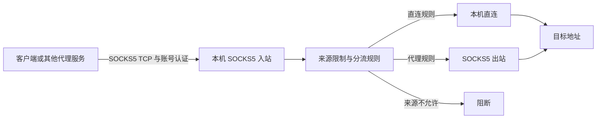

# 架构与部署组合

[返回 README](../README.md)

## 入站、路由与出站

本工具按本机的入站和出站组织配置。入站负责接收 SOCKS5 客户端连接，路由按模式与来源限制选择直连、SOCKS5 出站或阻断。每台机器可独立部署，再按需要与其他 SOCKS5 服务组合。

图中 SOCKS5 出站表示一条连接已配置 SOCKS5 服务的代理路径。全部直连时无需配置该路径；来源阻断仅在启用白名单时使用。

## 部署组合

| 组合 | 行为 | 适用场景 |
| --- | --- | --- |
| 仅入站 | 接收客户端连接，流量由本机直连 | 独立 SOCKS5 代理 |
| 入站 + 域名分流出站 | 匹配域名通过 SOCKS5 出站，其余由本机直连 | 按目标域名选择访问路径 |
| 入站 + 全局出站 | 入站接收的流量全部通过 SOCKS5 出站 | 统一代理出口 |
| 仅出站 | 保存连接信息与分流配置，不接收客户端连接 | 先准备出站，之后添加入站 |

同一台机器管理一个实例，包含一个可选 SOCKS5 入站和一个可选 SOCKS5 出站。仅配置出站时没有监听端口，服务保持停止并关闭开机启动；它不会设置系统全局代理或接管本机应用流量。

入站与出站可按任意顺序安装，分别修改或卸载。卸载入站会停止服务、关闭开机启动并保留出站配置；卸载出站会保留入站，让入站流量恢复本机直连。操作细节见[配置说明](configuration.md)。

## 组件职责

| 组件 | 职责 |
| --- | --- |
| Bash 管理脚本 | 交互菜单、安装、配置应用、升级与卸载 |
| jq 与 JSON 模板 | 校验输入、归一化状态、生成 Xray 运行配置 |
| Xray | SOCKS5 TCP CONNECT、账号认证、来源限制与分流 |
| systemd | 管理服务进程与开机启动 |

配置应用前检查输入、端口和 Xray 配置，通过后原子替换文件。启动失败时恢复旧配置与运行状态。系统防火墙与云安全组由用户自行管理。

核心配置参考 Xray 官方 [SOCKS 入站](https://xtls.github.io/config/inbounds/socks.html)、[SOCKS 出站](https://xtls.github.io/config/outbounds/socks.html)和[路由](https://xtls.github.io/config/routing.html)。
